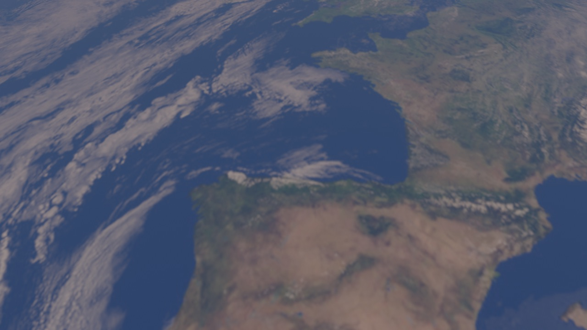
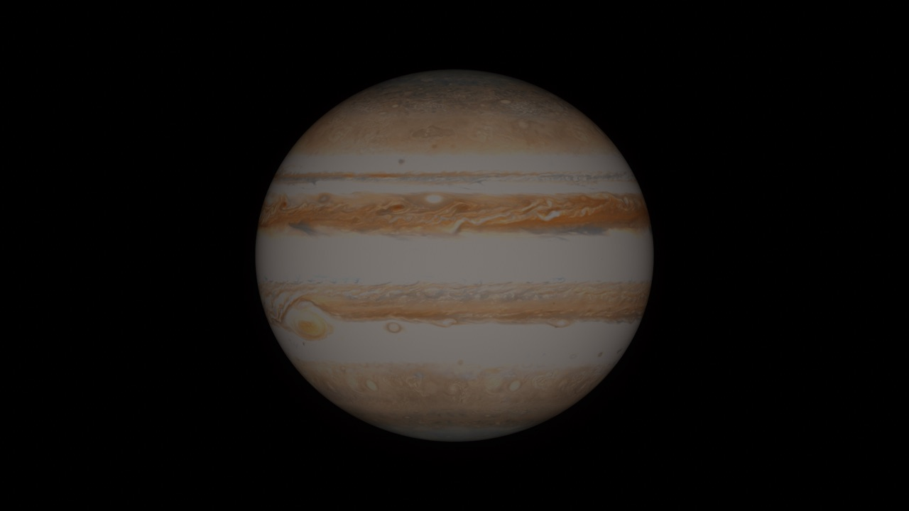
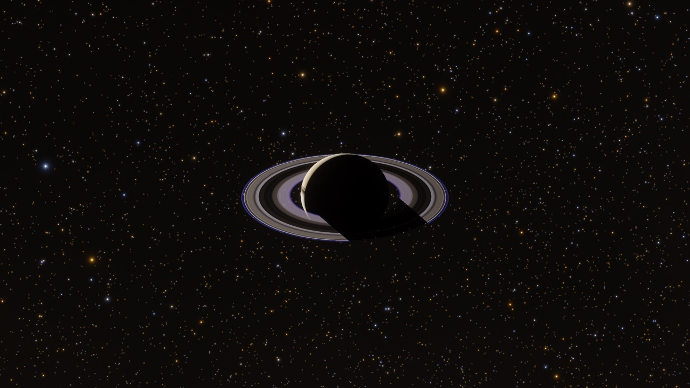
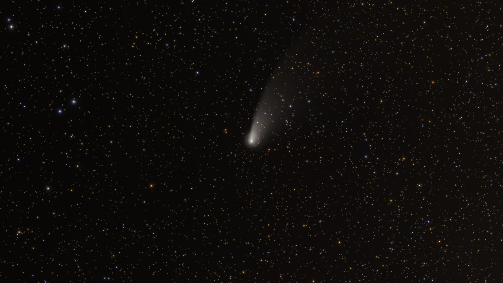
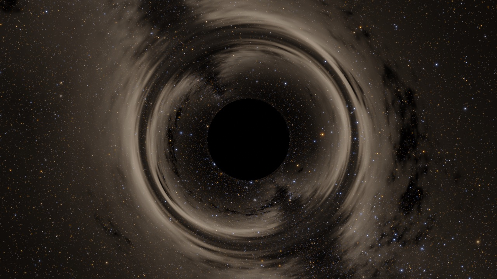
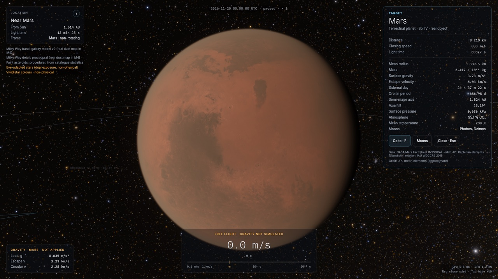
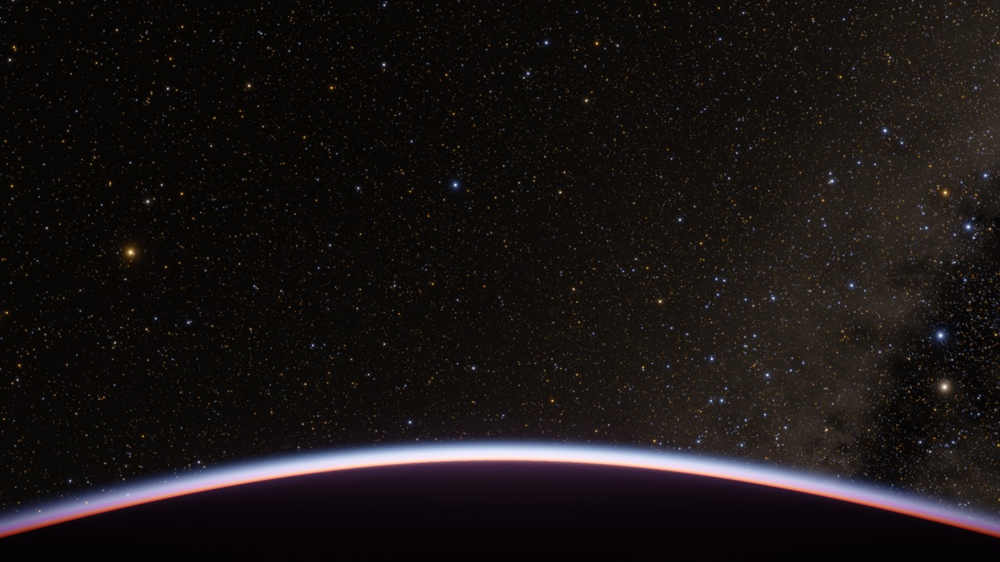

# Universe Explorer

A real-time space renderer written from scratch in Rust and WGSL on wgpu. You can fly continuously from low orbit
around Earth to the outer planets, past comets and asteroids, out to nearby stars and past a black hole, at true
sizes and distances, with no loading screens. Positions, brightness and colour come from published ephemerides,
catalogues and photometry. Anything approximate or non-physical is labelled on screen.



<p>






</p>

All images are unedited frames rendered by the engine at 1920x1080 (scaled down here).

## Status

| Milestone | Content | State |
|---|---|---|
| M0 Foundation | precision model, renderer core, black-hole lensing, capture and benchmark tooling | done |
| M1 Solar System and sky | planets, moons, rings, atmospheres, 3-D star sky, comets, asteroids, navigation, HUD | done |
| M2 Planet surfaces | terrain, clouds, oceans | planned |
| M3 Black holes | accretion disks, relativistic effects | planned |
| M4 The galaxy | the Milky Way in 3-D | planned |
| M5 and M6 | procedural planetary systems, travel across the deep universe | planned |

## Features

**Scale and precision**
- Positions are 64-bit integer cells plus f64 offsets: sub-millimetre locally, a range of about 1e32 m. They are made
  camera-relative in f64 on the CPU and handed to the GPU as f32.
- Reversed-Z depth with an infinite far plane, so a planet's surface and a distant star share one depth buffer.

**Rendering**
- HDR pipeline: GPU histogram auto-exposure, six-level bloom, AgX-style tonemapping, dithering and upscaling.
- Planets and moons as analytic ellipsoids with an exact limb, BC7-compressed surface maps, eclipses and shadows, and
  an exposure-blended handover from point of light to resolved disk.
- Saturn's rings from a measured ring-particle model; star surfaces with limb darkening and granulation.
- Physically based atmospheres for Earth, Mars, Venus and Titan.
- About 333 000 stars in 3-D with blackbody colours, a glare model fitted to the CIE glare formula and atmospheric
  twinkling, in front of a procedural Milky Way band.
- Comets with Finson-Probstein dust tails (dust grains under solar radiation pressure) and CO+ ion tails coloured from
  their emission bands, with brightness calibrated on measurements of comet NEOWISE (2020).
- The asteroid belt: about 34 000 catalogued asteroids plus a 100 000-particle statistical belt.
- Black-hole gravitational lensing: light paths integrated along exact Schwarzschild geodesics on the GPU, checked
  against a CPU tracer and against the analytic shadow size.

**Physics and astronomy**
- Planet positions from published orbital-element theories, tested against JPL Horizons; analytic theories for the
  Moon, Pluto and the major moons of Jupiter and Saturn; IAU rotation models.
- Barycentric dynamical time with leap seconds, and time warp.
- Comet and asteroid orbits integrated with RK4, including planetary perturbations (about 17 800 tracked objects).
- Apparent magnitudes from published photometric models.
- Every physical constant and formula in the source cites the paper, catalogue or standard it comes from.

**Navigation and interface**
- Six-degree-of-freedom flight with a logarithmic speed range from 0.1 m/s to 1e26 m/s.
- Click to select, information cards, autopilot to any object, cruise, time controls and bookmarks.

**Verification**
- `--capture` renders fixed bookmarks to PNG with an HDR sidecar and a JSON file of measurements.
- `--bench` measures p95 GPU, CPU and frame-interval times over sustained runs.
- `--selftest` runs GPU compute probes that check the important shader routines against their CPU twins.
- `uni-verify` runs the numeric checks on captures (positions, disk sizes, fluxes, angles, the black-hole shadow
  radius) and builds contact sheets.

## Measured performance

On an Apple M3 MacBook Air (fanless, 8-core GPU) at 1920x1080 internal resolution, all ten benchmark views of the
Solar System hold 112 to 238 fps over the last 10 seconds of sustained 60-second runs, with the 95th-percentile GPU
time per frame at 4.2 to 9.7 ms and CPU time at 0.9 to 3.9 ms.

## Building and running

Requirements: macOS on Apple silicon (the renderer targets Metal) and Rust 1.100 or newer
(install it from https://rustup.rs).

```sh
git clone https://github.com/aayans08/blackHoleSim.git
cd blackHoleSim
cargo build --release -p uni-app
./target/release/universe
```

The window opens at the `start` view in the Solar System. A first flight:

1. Hold the right mouse button and drag to look around.
2. Left-click a planet to select it; press `I` to open its information card.
3. Press `F` to fly there with the autopilot; `Esc` cancels.
4. Use `W A S D` to move and the mouse wheel to change speed. Speed runs from walking pace to faster than light
   (speeds above c are labelled as non-physical).
5. Press `T` for the time panel, `.` and `,` to speed time up or slow it down, `P` to pause.

To open the window at another view, pass a bookmark name from `bookmarks/m1.ron`, for example
`./target/release/universe --start saturn-ring-plane`.

Surface maps are large and are not in the repository. Without them the planets render with uniform albedo and the
HUD says "No surface map". To build them, download the maps listed in `data/manifest.toml` into `data/cache/` and run
`uni-bake map` with the parameters recorded in `data/baked/maps/index.ron`.

## Controls

| Input | Action |
|---|---|
| Right mouse drag | look around |
| W A S D | move forward, left, back, right |
| Space / Left Ctrl | move up / down |
| Q / E | roll |
| = / - or mouse wheel | speed up / down |
| Left click | select an object |
| F | fly to the selection |
| C | cruise |
| I | information card |
| T | time panel |
| P | pause time |
| . / , | time faster / slower |
| Esc | cancel or deselect |
| Tab | hide the HUD (honesty labels stay) |
| F12 | screenshot |
| F1 | help |

## Command line

```sh
universe                                   # open the window at the start view
universe --start <bookmark>                # open the window at a named view
universe --capture bookmarks/m1.ron --out captures/m1 [--size 1920x1080] [--hud] [--hdr]
                                           # render every view to PNG + JSON without a window
universe --bench bookmarks/m1-bench.ron [--sustained 60] [--json out.json]
                                           # measure frame times
universe --selftest                        # check the GPU shader maths against the CPU
```

Contact sheet of a capture folder: `cargo run --release -p uni-verify -- contact --captures captures/m1 --out sheet.png`.

## Repository layout

| Path | Contents |
|---|---|
| `crates/uni-core` | units, positions, time, frames, colour |
| `crates/uni-gfx` | GPU context, frame contract, timing, shader library, probes |
| `crates/uni-physics` | ephemerides, rotation, photometry, small-body dynamics |
| `crates/uni-sim` | the simulated world: object registry, cached states, snapshots |
| `crates/uni-data` | catalogue and map loaders |
| `crates/uni-sky` | stars, the Milky Way band, asteroids |
| `crates/uni-planet` | planets, moons, rings, the Sun, comets |
| `crates/uni-atmo` | atmospheres |
| `crates/uni-rel` | black-hole lensing |
| `crates/uni-post` | exposure, bloom, tonemapping |
| `crates/uni-procgen` | procedural galaxy model and faint stars |
| `crates/uni-nav` | camera, input, bookmarks |
| `crates/uni-ui` | HUD |
| `crates/uni-app` | the `universe` binary |
| `tools/bake` | data baking (`uni-bake`) |
| `tools/verify` | capture checks and contact sheets (`uni-verify`) |
| `bookmarks/` | capture and benchmark views |
| `data/` | baked catalogues and the data manifest |

## License

The source code is released under the MIT License (see `LICENSE`). The catalogues, maps and derived data files keep
their own licences, several of which require attribution or share-alike terms; `ATTRIBUTION.md` lists each source and
its licence.
